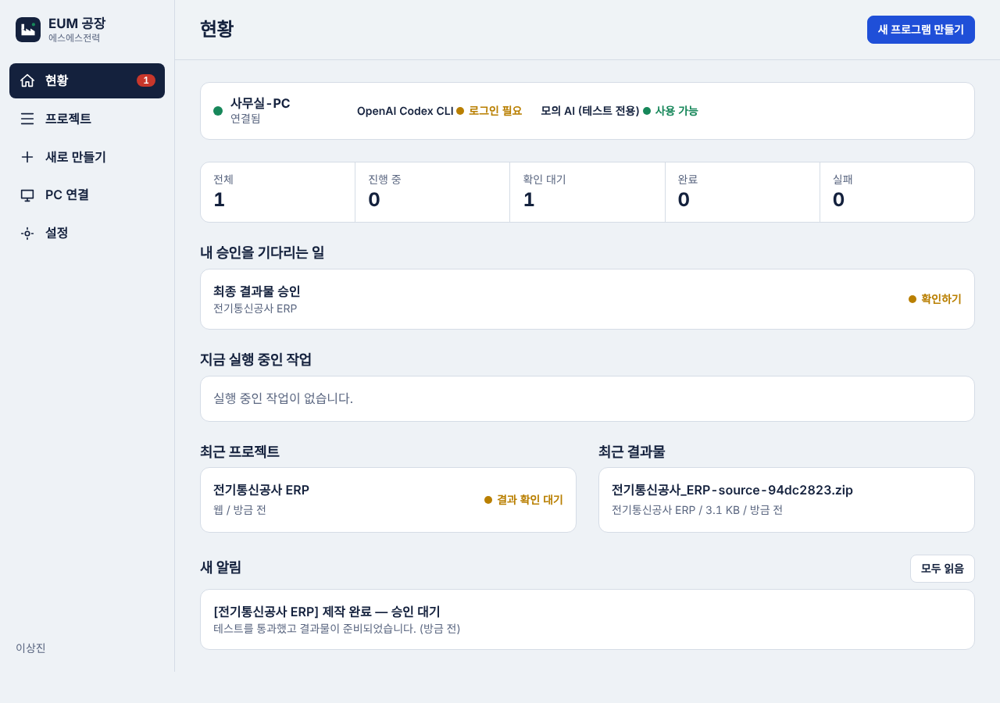
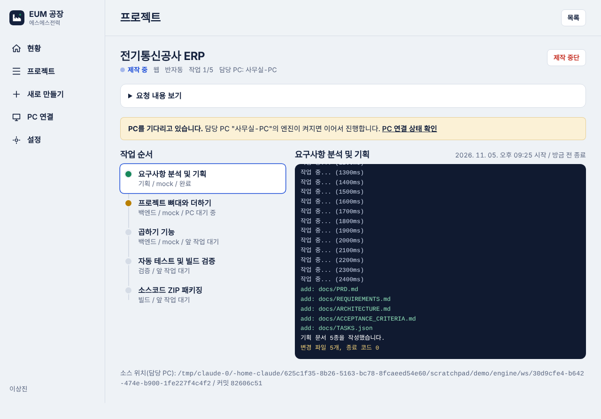
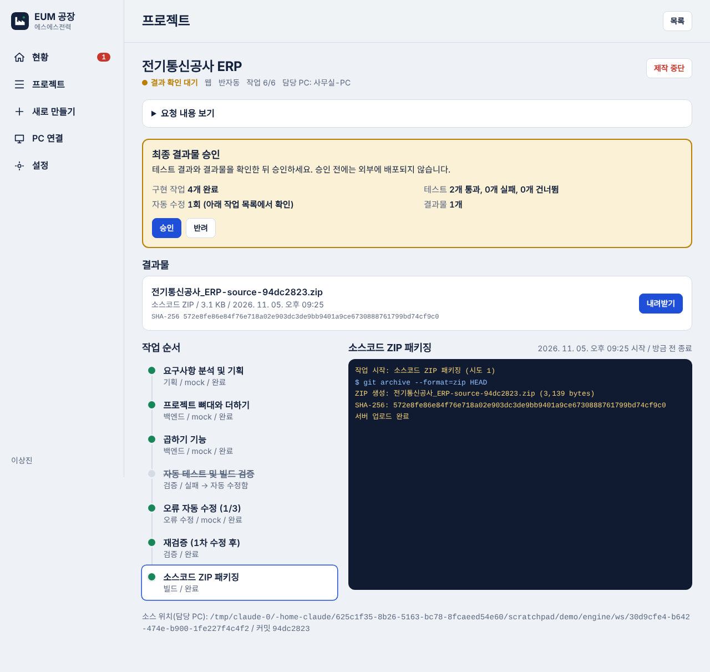
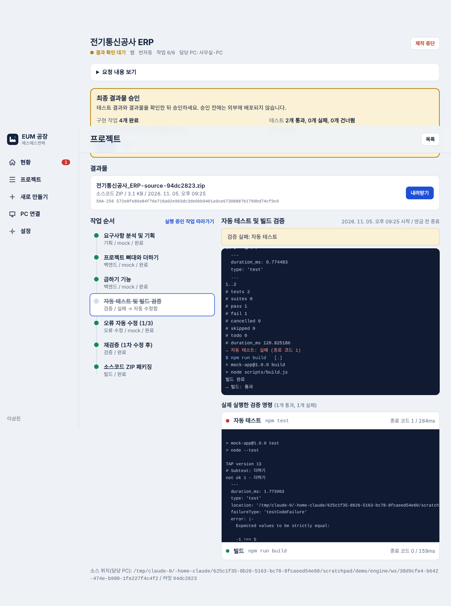
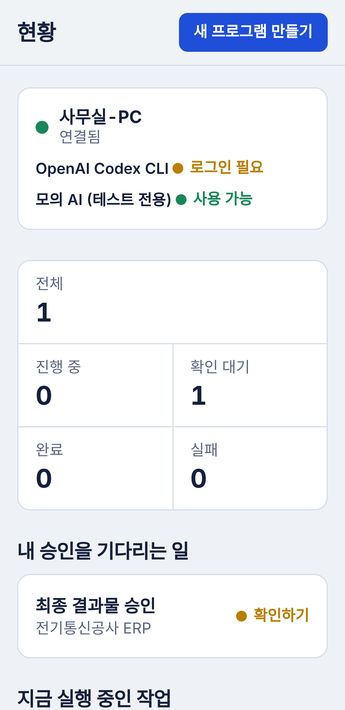

# 실제 테스트 결과 보고서

- 실행일: 2026-11-05
- 실행 환경: 클라우드 Linux (Ubuntu 24.04), Node.js v22.23.4, PostgreSQL 16.15, Git 2.43.0, Codex CLI 0.166.0(설치만, 로그인 안 됨)
- 대상: 저장소 `main` 브랜치의 최종 코드. 아래 결과는 모두 마지막 코드 변경 뒤에 다시 실행한 것입니다.

## 요약

| 구분 | 결과 |
| --- | --- |
| 빌드 (서버·엔진·웹) | 성공 |
| 서버 자동 테스트 | 16건 중 16건 통과 |
| PC 엔진 자동 테스트 | 10건 중 10건 통과 |
| 전체 흐름(E2E) | 7개 시나리오 중 7개 통과 |
| 웹 타입 검사 | 통과 |
| 운영 의존성 취약점(`npm audit --omit=dev`) | 0건 |
| 브라우저 화면 확인 (PC 1280px, 휴대폰 크기) | 전체 흐름 조작 성공, 가로 넘침 없음 |
| Railway 배포 | 빌드·기동·상태 확인(`/api/health`) 통과 |

## 이 보고서가 증명하지 않는 것

- **실제 Codex가 코드를 만드는 것.** 이 환경에서는 ChatGPT 계정에 로그인할 수 없어, E2E의 AI 자리는 테스트 전용 모의 어댑터가 대신했습니다. 모의 어댑터는 정해진 작은 Node.js 프로젝트를 쓰는 프로그램이며, 그 뒤의 Git 기록·테스트 실행·수정 반복·ZIP·다운로드는 모두 실제로 수행됩니다. Codex 어댑터 자체는 실제 Codex CLI의 설치·로그인 감지와, 같은 명령 규칙을 따르는 대역 프로그램으로 확인했습니다.
- **Windows에서의 동작**, Windows 설치 패키지, Android APK, Docker Compose 실행. ([STATUS.md](STATUS.md) 2장)
- 배포된 Railway 주소를 브라우저로 직접 여는 것. 개발 환경의 네트워크 제한으로 외부 주소에 접속할 수 없어, Railway의 배포 상태 확인과 서버 기동 로그로만 확인했습니다.

## 서버 자동 테스트 (실제 PostgreSQL 사용)

`npm test -w apps/server`

```
✔ 마이그레이션: 지시서의 26개 테이블이 모두 생성된다 (360.858976ms)
✔ TASKS.json 검증: 형식 오류·알 수 없는 의존성·순환 의존을 거부한다 (4.824012ms)
✔ 인증: 로그인 없이는 접근할 수 없고, 잘못된 비밀번호는 거부된다 (226.994003ms)
✔ 조직 격리: 다른 조직의 프로젝트·승인·결과물에 접근할 수 없다 (179.127637ms)
✔ PC 등록: 연결 코드는 한 번만 쓸 수 있고, 토큰은 해시로만 저장된다 (74.270523ms)
✔ 작업 임대: 두 PC 가 동시에 요청해도 한 작업은 한 PC 에만 배정된다 (145.760109ms)
✔ 완료 판정: AI 가 완료했다고 해도 실제 변경·산출물이 없으면 성공 처리하지 않는다 (146.254868ms)
✔ 중복 방지: 같은 완료 보고·이벤트를 다시 보내도 한 번만 반영된다 (118.224085ms)
✔ 작업 분할: 유효한 TASKS.json 은 의존성이 있는 개발 작업으로 확장된다 (135.793231ms)
✔ 검증: 실제 테스트 결과가 없으면 통과 처리하지 않고, 실패하면 수정 작업을 만든다 (165.55929ms)
✔ 재시도 한도: 자동 수정 3회를 모두 쓰면 무한 반복하지 않고 실패로 보고한다 (223.118123ms)
✔ 결과물: 해시가 다르면 거부하고, 업로드된 파일이 있어야 패키징이 완료된다 (240.074639ms)
✔ 수동 승인 모드: 승인 전에는 AI 작업이 PC 로 전달되지 않는다 (103.519632ms)
✔ 복구: 임대가 만료된 작업은 대기열로 돌아가고, 늦게 온 보고는 무시된다 (114.405872ms)
✔ 취소: 대기 작업은 즉시 취소되고 실행 중 작업에는 중단 신호가 전달된다 (83.542979ms)
✔ 감사 로그: 주요 행위가 기록된다 (0.97431ms)
ℹ tests 16
ℹ suites 0
ℹ pass 16
ℹ fail 0
ℹ cancelled 0
ℹ skipped 0
ℹ todo 0
ℹ duration_ms 2771.246649
```

## PC 엔진 자동 테스트

`npm test -w apps/engine`

```
✔ 경로 격리: 작업 폴더 밖 경로와 심볼릭 링크 탈출을 차단한다 (2.24527ms)
✔ 환경변수: 엔진 비밀정보(EUM_*)는 하위 프로세스에 전달하지 않는다 (37.825811ms)
✔ 서버 주소: 원격 서버는 HTTPS 만 허용한다 (0.442812ms)
✔ 프로세스 실행: 제한 시간을 넘기면 자식 프로세스까지 종료한다 (3010.132488ms)
✔ Git 체크포인트: 변경 파일을 실제 diff 로 수집하고, 미완료 변경은 되돌린다 (79.248695ms)
✔ 검증 계획: package.json 스크립트에서 고정 명령만 만든다 (1.50786ms)
✔ 검증 실행: 실제 명령의 종료 코드로 통과·실패를 판정한다 (775.245336ms)
✔ Codex 이벤트 변환: codex exec --json 출력을 한국어 로그 이벤트로 바꾼다 (0.689439ms)
✔ Codex 어댑터: 설치·로그인 확인과 종량제 API 차단 (188.53ms)
✔ Codex 어댑터: 작업 폴더에서 샌드박스 옵션으로 실행하고, 지시문은 표준 입력으로 전달한다 (371.564578ms)
ℹ tests 10
ℹ suites 0
ℹ pass 10
ℹ fail 0
ℹ cancelled 0
ℹ skipped 0
ℹ todo 0
ℹ duration_ms 4534.260216
```

## 전체 흐름 (E2E)

`npm run test:e2e` — 서버 프로세스 1개와 PC 엔진 프로세스 7개를 실제로 띄우고, 웹 API로 제작을 요청합니다.

```
EUM E2E 검증 시작
  ✔ 실행 중 취소: 사용자가 취소하면 PC 의 작업 프로세스가 중단됨 (13.4초)
  ✔ 정상 흐름: 요청 → 기획 → 작업 분할 → 구현 → 테스트 → ZIP → 다운로드 → 승인 (14.6초)
  ✔ 허위 완료 차단: AI 가 완료라고 해도 산출물이 없으면 실패 (15.0초)
  ✔ 자동 오류 수정: 테스트 실패 → 수정 작업 → 재검증 통과 (16.6초)
  ✔ 수동 승인 모드: 승인할 때마다 한 단계씩 진행 (19.5초)
  ✔ 재시도 한도: 수정 3회 실패 시 중단하고 실패 보고 (결과물 없음) (22.4초)
  ✔ 장애 복구: PC 엔진 강제 종료 → 임대 만료 회수 → 재시작 후 완료 (39.1초)

결과: 7/7 통과
```

각 시나리오가 확인하는 내용:

| 시나리오 | 확인 내용 |
| --- | --- |
| 정상 흐름 | 작업 5개(기획, 개발 2, 검증, 패키징) 완료. `npm test` 와 `npm run build` 의 종료 코드 0 기록. 내려받은 ZIP의 SHA-256이 서버 기록과 일치. ZIP을 풀어 `npm test` 를 다시 실행해 통과. 로그 순번에 빠짐 없음. WebSocket으로 실시간 로그 수신. 최종 승인 후 "완료" |
| 자동 오류 수정 | 일부러 버그를 넣은 구현 → `npm test` 실패(종료 코드≠0, 실패한 테스트 이름이 로그에 있음) → 수정 작업 → 재검증 통과 |
| 재시도 한도 | 고쳐지지 않는 버그 → 수정 3회 후 중단, 프로젝트 "실패", 결과물 0개 |
| 허위 완료 차단 | AI가 "완료했습니다"만 출력하고 파일을 만들지 않음 → 3회 시도 후 "필수 산출물이 생성되지 않았습니다"로 실패 |
| 장애 복구 | 작업 중 엔진을 `kill -9` → 임대 만료로 회수 → 재시작 후 2번째 시도 → 다시 강제 종료 후 즉시 재시작 → 3번째 시도로 끝까지 완료 |
| 실행 중 취소 | 30초짜리 작업 실행 중 취소 → PC의 작업이 중단되고 모든 작업 "취소됨" |
| 수동 승인 모드 | 승인 전에는 작업이 실행되지 않음. 승인 3회로 완료 |

## 브라우저 확인

실제 Chromium으로 가입 → 연결 코드 발급 → PC 등록 → 제작 요청 → 실행 중 로그 → 검증 실패·자동 수정 → 결과물 내려받기까지 조작했습니다.

| 화면 | 캡처 |
| --- | --- |
| 현황 |  |
| 프로젝트 (실행 중) |  |
| 프로젝트 (결과 승인 대기) |  |
| 검증 실패 로그 |  |
| 휴대폰 현황 |  |

브라우저 콘솔 오류는 글꼴 CDN 접속 실패뿐이었습니다(개발 환경의 네트워크 제한 때문이며, 이 경우 기기 기본 글꼴로 표시됩니다).

## 의존성 취약점

- 운영에 포함되는 의존성: 0건
- 빌드에만 쓰는 의존성: 2건(높음 1, 보통 1). Next.js에 포함된 postcss이며 서버에 배포되는 이미지에는 들어가지 않습니다. Next.js 다음 버전에서 해소되면 올리면 됩니다.

## PHASE 1 완료 기준 대조

> 사용자가 웹에서 프로그램 제작을 요청하면 PC의 Codex가 실제 소스코드를 만들고, 빌드 또는 테스트를 실행한 뒤 웹에서 결과를 확인할 수 있어야 합니다.

| 단계 | 상태 |
| --- | --- |
| 웹에서 제작 요청 | 확인됨 |
| PC 엔진이 작업을 받아 실행 | 확인됨 |
| **Codex가 실제 소스코드 생성** | **미확인 — 사용자 PC에서 `codex login` 후 확인 필요** |
| 빌드·테스트 실행 | 확인됨 |
| 웹에서 결과 확인·다운로드 | 확인됨 |

따라서 PHASE 1은 "Codex 실제 실행 한 단계만 사용자 PC에서 확인하면 완료"인 상태입니다. 그 확인 전에는 PHASE 2로 넘어가지 않는 것이 지시서의 원칙에 맞습니다.
